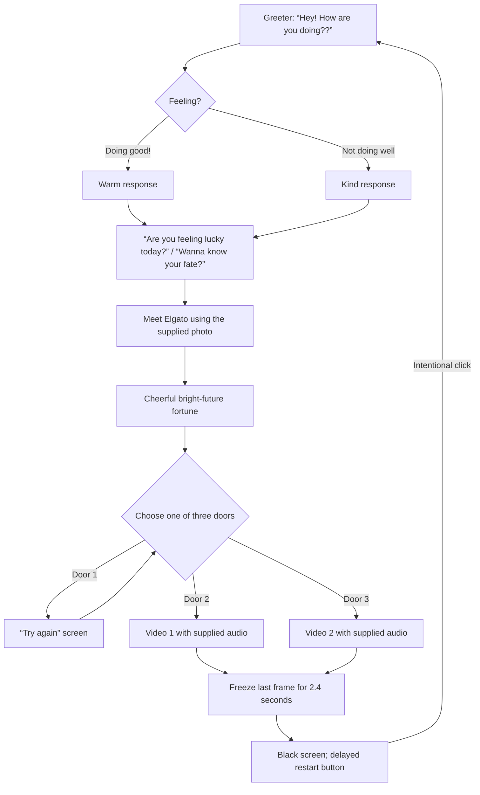

# User flow: Elgato

## Interaction notes

- The greeting choice determines the greeter's next line. Continue advances to the two fortune questions.
- Door 1 has one short outcome screen. Its **Try again** button returns straight to door selection.
- Door 2 and Door 3 call the jumpscare component from the actual door click. Fullscreen is requested there where supported, and `play()` is called directly from the same gesture. There is no automatic muted fallback.
- A completed clip holds its final video frame on canvas for 2.4 seconds, then transitions to black. A low-contrast restart button appears after five seconds of darkness; before that the screen remains blank.
- Restart closes fullscreen where supported, clears the media source, and returns to the first greeting.
